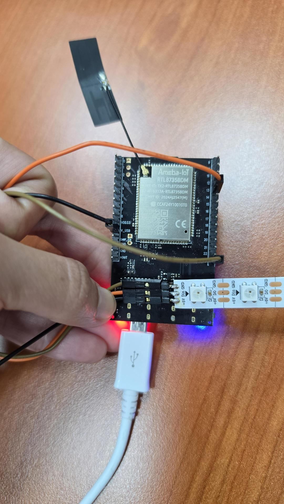
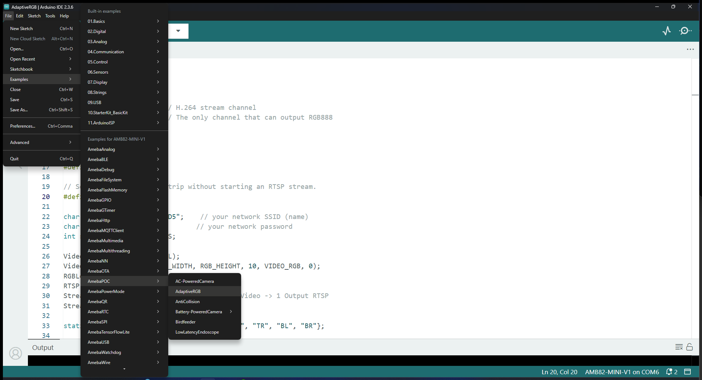
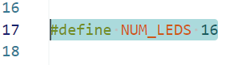
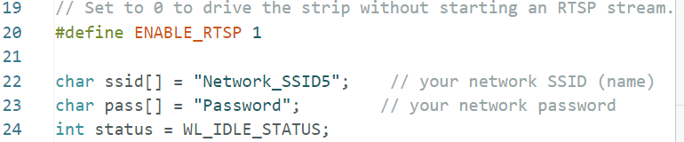
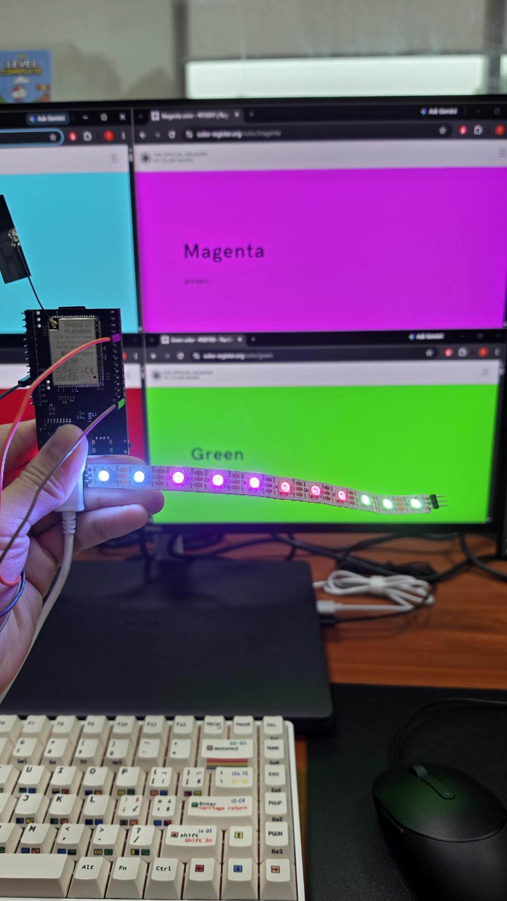
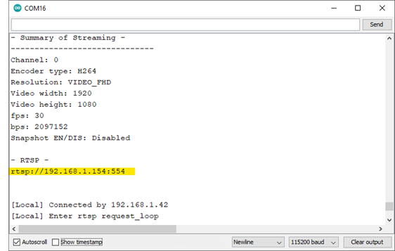
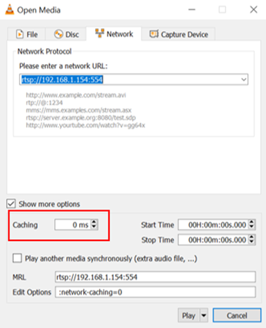
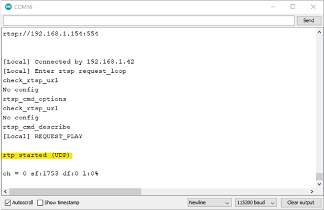

AdaptiveRGB
===========

.. contents::
  :local:
  :depth: 2

Materials
---------
- `AMB82-mini <https://www.amebaiot.com/en/where-to-buy-link/#buy_amb82_mini>`_ x 1
- Camera Module (eg. JX-F37) x 1
- Female-to-Female Jumper Wires x 3
- WS2812B Strip with at least 4 LEDs

Introduction
------------

This proof of concept example aims to control the WS2812B LED strip by changing the colors emitted based on colors that the camera sees.

How it Works
------------
AMB82-Mini set ups an SPI MOSI pin to send data to the WS2812B LED to change its colors and brightness along with an optional RTSP video stream over WiFi. Two separate channels are used. Channel 0 is used to output the RTSP video stream while channel 3 is used to by the module_rgbled to read the RGB888 data gotten from the camera sensor itself. 

The idea is to use a substream of smaller resolution and virtually splitting it into four equal quadrants. The midpoint of each quadrant will be used to drive the colors of each one-quarter of the LED strip. For example a WS2812B with 17 LEDs, the colors for the LEDs [0:3, 4:7, 8:11, 11:16] will take on the midpoint pixel value of the quadrants [TopLeft, TopRight, BottomLeft, BottomRight].

Getting Started
---------------
- Connect the respective pins on the AMB82-Mini to the WS2812B LED strip using the jumper wires. 

"+5V" <-> "V_USB" 

"DIN" <-> "SPI_MOSI"

"GND" <-> "GND"

|image01|

- Find the POC example under "Files" -> "Examples" -> "POC" -> "AdaptiveRGB" from the top left corner of the ArduinoIDE.
|image02|

- Update NUM_LEDS to match the number of LEDs on the WS2812B strip.
|image03| 

- When ENABLE_RTSP is set to 1, edit the WiFi network ID and Password in the following sections. Your viewing device will have to be connected to the same WiFi network to watch the stream later.
|image04|

- Select the camera module that going to use from `Tools -> Camera Options`

.. note:: Please make sure the camera is supported otherwise system will returns "sensor ID error" or "VOE not init".

- Compile and upload the code into AMB82-Mini and reset the board to start running the POC example. After pressing the Reset button, wait for the Ameba board to connect to the WiFi network. The board's IP address and network port number for RTSP will be shown in the Serial Monitor. 

- Simply point the camera at various objects or scenes to watch it change colors.
|image05|

- Make sure your PC is connected to the same network as the Ameba Pro2 board for streaming. Since RTSP is used as the streaming protocol, key in `"rtsp://{IPaddress}:{port}"` as the Network URL in VLC media player, replacing {IPaddress} with the IP address of your Ameba Pro2 board, and {port} with the RTSP port shown in Serial Monitor `(e.g., "rtsp://192.168.1.154:554")`. The default RTSP port number is 554.
|image06|

- You may choose to change the caching time in "Show more options". A lower cache time will result in reduced video latency but may introduce playback stuttering in the case of poor network conditions.
|image07|

- Next, click "Play" to start RTSP streaming. The video stream from the camera will be shown in VLC media player. Meanwhile, in your Serial Monitor, the message "rtp started (UDP)" will appear.

|image08|

