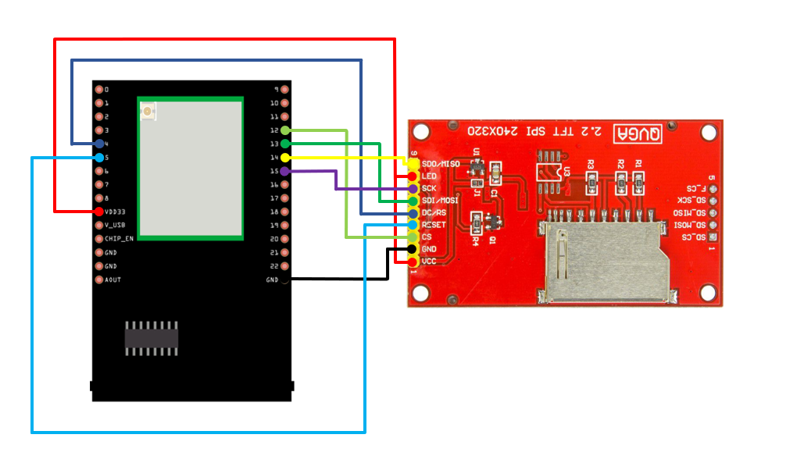
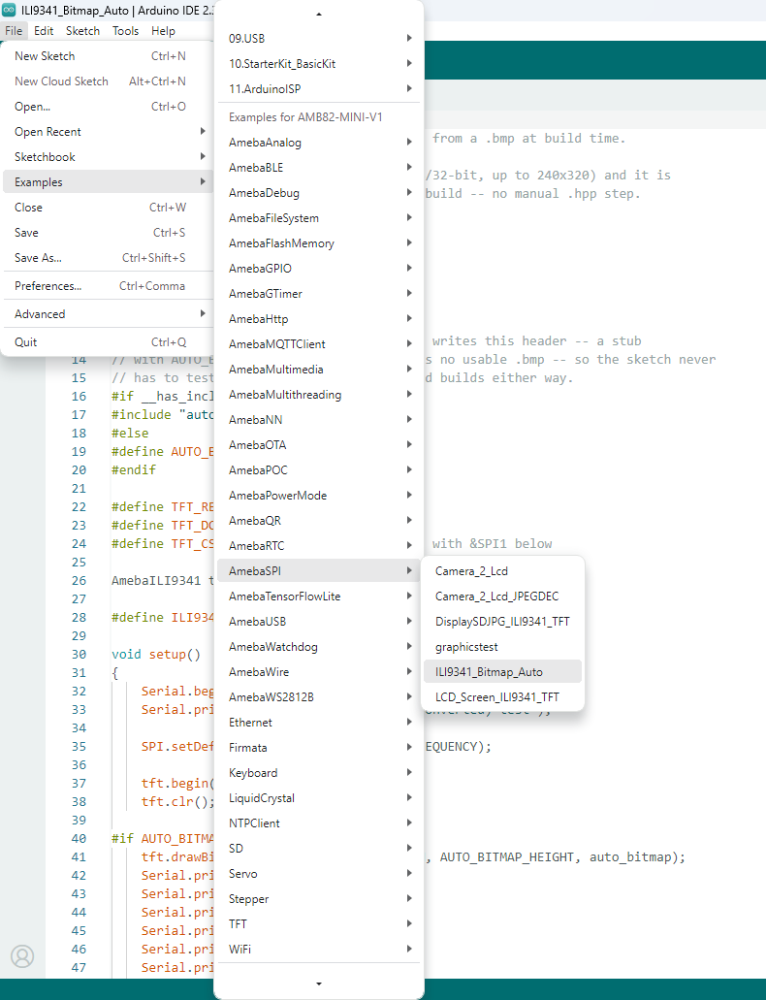

ILI9341 Bitmap Auto
===================

Materials
---------

- `AMB82-mini <https://www.amebaiot.com/en/where-to-buy-link/#buy_amb82_mini>`__ x 1
- ILI9341 TFT LCD display x 1

Example
-------

In this example, we will use the Ameba Pro2 board to display
a BMP image on an ILI9341 TFT LCD through SPI communication.
The BMP image will be automatically converted into a header
file during compilation, without requiring users to manually
convert the image.

Connect the ILI9341 TFT LCD display to the AMB82-mini board
using the SPI interface.

|image01|

Open the sample code in :guilabel:`File -> Examples -> AmebaSPI -> ILI9341_Bitmap_Auto`.

|image02|

Prepare a BMP image in 16-bit, 24-bit, or 32-bit format,
with a maximum resolution of 240 x 320 pixels.

Place the BMP image in the same folder as the
``ILI9341_Bitmap_Auto.ino`` sketch.

During compilation, the BMP image will be automatically
converted into a header file named ``auto_bitmap.h``.
The converted image data will be included in the sketch.

The following code initializes the ILI9341 TFT LCD display
and displays the converted bitmap image.

.. code-block:: cpp

   #if AUTO_BITMAP_PRESENT
       tft.drawBitmap(0, 0, AUTO_BITMAP_WIDTH,
                      AUTO_BITMAP_HEIGHT, auto_bitmap);
   #endif

Compile and upload the code to Ameba, then press the
reset button.

Open the Serial Monitor and set the baud rate to 115200.
When the bitmap image is successfully displayed,
the image filename and resolution will be printed
in the Serial Monitor.

The converted BMP image will be displayed on the
ILI9341 TFT LCD screen.

Additional
----------

Users can replace the BMP image in the sketch folder
with another supported image and recompile the sketch.
The image will be automatically converted during
the next build.

The SPI frequency is configured to 20 MHz by default,
as shown below:

.. code-block:: cpp

   #define ILI9341_SPI_FREQUENCY 20000000

The TFT display control pins are defined as follows:

.. code-block:: cpp

   #define TFT_RESET 5
   #define TFT_DC    4
   #define TFT_CS    SPI_SS

Ensure that the ILI9341 TFT LCD is connected to
the correct SPI and control pins.

If no valid BMP image is found, the example will
display a message in the Serial Monitor indicating
that no image was drawn.

