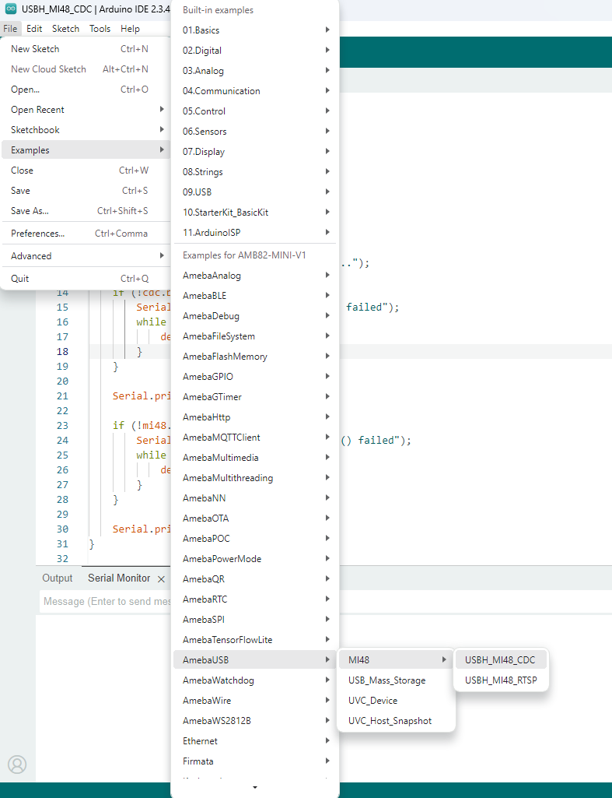
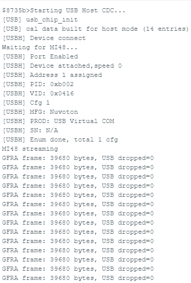
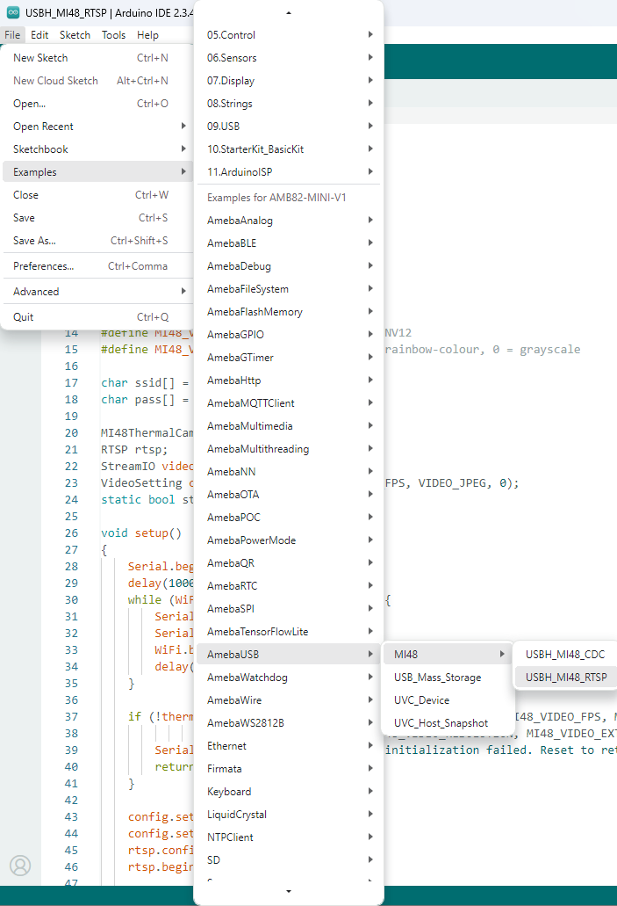
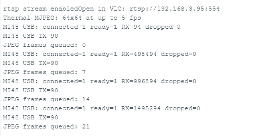
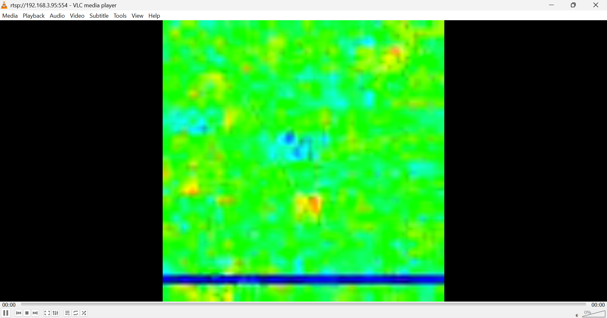

MI48 Thermal Camera
===================

Materials
---------

- `AMB82-mini <https://www.amebaiot.com/en/where-to-buy-link/#buy_amb82_mini>`__ x 1
- MI48 thermal imaging camera x 1
- PC with VLC Media Player installed x 1

Example
-------

AmebaPro2 supports USB Host Communication Device Class (CDC), allowing users to connect an external MI48 thermal imaging camera to the Ameba board through USB. The following examples demonstrate how to receive thermal image data from the MI48 camera and stream the thermal images over Wi-Fi using Real-Time Streaming Protocol (RTSP).

Connect the "Micro USB" port of AMB82-mini to the PC for programming. Connect the MI48 thermal imaging camera to the "USB OTG" port.

**Example 1: USBH_MI48_CDC**

Open the example in :guilabel:`File -> Examples -> AmebaUSB -> MI48 -> USBH_MI48_CDC`. Compile and upload to Ameba, then press the reset button.

|image01|

Open the Serial Monitor and set the baud rate to 115200 to review the USB Host CDC initialization and MI48 connection logs.

Once the MI48 camera is successfully connected, the following message will be displayed in the Serial Monitor:

.. code-block:: text

   Starting USB Host CDC...
   Waiting for MI48...
   MI48 streaming

The Ameba board will continuously receive GFRA frame data from the MI48 camera. The received frame payload size and USB dropped-byte count will be displayed in the Serial Monitor.

|image02|

**Example 2: USBH_MI48_RTSP**

This example demonstrates how to capture thermal images from the MI48 camera and stream them over Wi-Fi using RTSP. The thermal video stream can be viewed on a PC using VLC Media Player.

Open the example in :guilabel:`File -> Examples -> AmebaUSB -> MI48 -> USBH_MI48_RTSP`.

|image03|

Modify the Wi-Fi credentials in the sample code to connect Ameba to your Wi-Fi network.

.. code-block:: cpp

   char ssid[] = "Network_SSID";
   char pass[] = "Password";

The default thermal camera settings are configured as follows:

.. code-block:: cpp

   #define MI48_VIDEO_WIDTH      64
   #define MI48_VIDEO_HEIGHT     64
   #define MI48_VIDEO_FPS        5
   #define MI48_VIDEO_RAINBOW    1

The MI48 camera is configured to capture thermal images at a resolution of 64 x 64 and a frame rate of up to 5 fps. Rainbow-colour mode is enabled by default.

Compile and upload the code to Ameba, then press the reset button.

Open the Serial Monitor and set the baud rate to 115200. Once Ameba is connected to the Wi-Fi network and the thermal camera is initialized successfully, the RTSP streaming URL will be displayed in the Serial Monitor.

|image04|

Open VLC Media Player on the PC and select :guilabel:`Media -> Open Network Stream`. Enter the RTSP URL displayed in the Serial Monitor and click :guilabel:`Play`.

Ensure that the PC and Ameba are connected to the same network.

The thermal images captured by the MI48 camera will be streamed to VLC Media Player through RTSP.

|image05|

To switch between rainbow-colour and grayscale output, modify the following parameter:

.. code-block:: cpp

   #define MI48_VIDEO_RAINBOW 1

Set the value to ``1`` for rainbow-colour mode or ``0`` for grayscale mode.

Ensure that the MI48 camera is properly connected to the USB OTG port before running either example.

