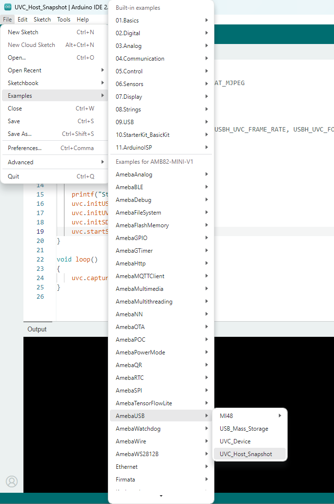
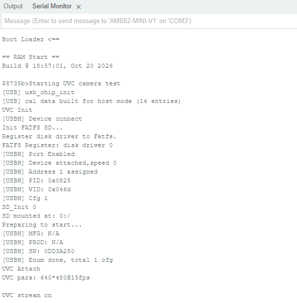
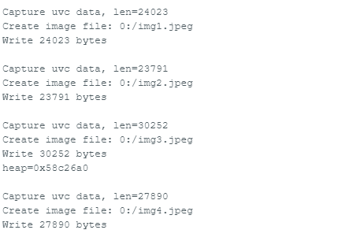

UVC Host Snapshot
=================

Materials
---------

- `AMB82-mini <https://www.amebaiot.com/en/where-to-buy-link/#buy_amb82_mini>`__ x 1
- USB Video Class (UVC) compatible USB camera x 1
- MicroSD card x 1

Example
-------

AmebaPro2 supports USB Video Class (UVC) Host functionality, allowing users to connect an external USB camera to the Ameba board and capture images. The captured images are saved in JPEG format to a MicroSD card.

Connect the "Micro USB" port of AMB82-mini to the PC for programming. Insert a MicroSD card into the AMB82-mini and connect a UVC-compatible USB camera to the "USB OTG" port.

Open the example in :guilabel:`File -> Examples -> AmebaUSB -> UVC_Host_Snapshot`. Compile and upload to Ameba, then press the reset button.

|image01|

The default UVC camera settings are configured as follows:

.. code-block:: cpp

   #define USBH_UVC_FORMAT_TYPE USBH_UVC_FORMAT_MJPEG
   #define USBH_UVC_WIDTH       640
   #define USBH_UVC_HEIGHT      480
   #define USBH_UVC_FRAME_RATE  15

The UVC camera is configured to capture images in MJPEG format at a resolution of 640 x 480 and a frame rate of 15 fps.

Open the Serial Monitor and set the baud rate to 115200 to review the initialization and image capture logs.

|image02|

|image03|

Once the USB camera is successfully detected, Ameba will initialize the UVC driver and start receiving frames from the camera. After the initial warm-up period, images will be automatically captured and saved to the MicroSD card.

The captured images are saved with sequential filenames, such as ``img0.jpeg``, ``img1.jpeg``, and ``img2.jpeg``.

Remove the MicroSD card, insert the MicroSD card into a PC to view the captured images.

