Ameba ARDUINO with AMB82-mini (RTL8735B)
========================================

Introduction
------------

Ameba is an easy-to-program platform for developing all kinds of IoT applications. AMB82 MINI is equipped with various peripheral interfaces, including WiFi, BLE, GPIO INT, I2C, UART, SPI, PWM, ADC. Through these interfaces, AMB82 MINI can connect with electronic components such as LED, switches, manometer, hygrometer, PM2.5 dust sensors, …etc. Besides, AMB82 MINI has 3 key features, Audio codec, Video codec and NN (build in NPU for AIoT). The collected data can be uploaded via WiFi and be utilized by applications on smart devices to realize IoT implementation.

AMB82 mini is connected to the open-source world by one of the widest development environments, Arduino. For more information, HDK, SDK, API documents, Example Guides and so on, refer to `Ameba Arduino SDK page <https://www.amebaiot.com/en/ameba-arduino-summary/>`__

|image01|

AMB82 MINI uses Micro USB to supply power, which is common in many smart devices.

Please refer to the following figure and table for the pin diagram and functions.

|image02|

+--------+----------+----------+---------+---------+------------+-----------+------------------------+----------+---------------+
|        | **GPIO** | **GPIO** | **ADC** | **PWM** | **UART**   | **SPI**   | **I2C**                | **SWD**  | **LED**       |
|        | **pin**  | **INT**  |         |         |            |           |                        |          |               |
+========+==========+==========+=========+=========+============+===========+========================+==========+===============+
| **0**  | PF5      | ✓        |         |         |            | SPI1_MISO |                        |          |               |
+--------+----------+----------+---------+---------+------------+-----------+------------------------+----------+---------------+
| **1**  | PF6      | ✓        |         | ✓       |            | SPI1_SCLK |                        |          |               |
+--------+----------+----------+---------+---------+------------+-----------+------------------------+----------+---------------+
| **2**  | PF7      | ✓        |         | ✓       |            | SPI1_MOSI |                        |          |               |
+--------+----------+----------+---------+---------+------------+-----------+------------------------+----------+---------------+
| **3**  | PF8      | ✓        |         | ✓       |            | SPI1_SS   |                        |          |               |
+--------+----------+----------+---------+---------+------------+-----------+------------------------+----------+---------------+
| **4**  | PF11     | ✓        |         | ✓       |            |           |                        |          |               |
+--------+----------+----------+---------+---------+------------+-----------+------------------------+----------+---------------+
| **5**  | PF12     | ✓        |         | ✓       |            |           |                        |          |               |
+--------+----------+----------+---------+---------+------------+-----------+------------------------+----------+---------------+
| **6**  | PF13     | ✓        |         | ✓       |            |           |                        |          |               |
+--------+----------+----------+---------+---------+------------+-----------+------------------------+----------+---------------+
| **7**  | PF14     | ✓        |         | ✓       |            |           |                        |          |               |
+--------+----------+----------+---------+---------+------------+-----------+------------------------+----------+---------------+
| **8**  | PF15     | ✓        |         | ✓       |            |           |                        |          |               |
+--------+----------+----------+---------+---------+------------+-----------+------------------------+----------+---------------+
| **9**  | PF2      | ✓        | A2      |         |            |           | I2C1_SDA (master only) |          |               |
+--------+----------+----------+---------+---------+------------+-----------+------------------------+----------+---------------+
| **10** | PF1      | ✓        | A1      |         |            |           | I2C1_SCL (master only) |          |               |
+--------+----------+----------+---------+---------+------------+-----------+------------------------+----------+---------------+
| **11** | PF0      | ✓        | A0      |         |            |           |                        |          |               |
+--------+----------+----------+---------+---------+------------+-----------+------------------------+----------+---------------+
| **12** | PE4      | ✓        |         |         |            | SPI_SS    | I2C_SDA (master only)  |          |               |
+--------+----------+----------+---------+---------+------------+-----------+------------------------+----------+---------------+
| **13** | PE3      | ✓        |         |         |            | SPI_MOSI  | I2C_SCL (master only)  |          |               |
+--------+----------+----------+---------+---------+------------+-----------+------------------------+----------+---------------+
| **14** | PE2      | ✓        |         |         | SERIAL3_RX | SPI_MISO  |                        |          |               |
+--------+----------+----------+---------+---------+------------+-----------+------------------------+----------+---------------+
| **15** | PE1      | ✓        |         |         | SERIAL3_TX | SPI_SCLK  |                        |          |               |
+--------+----------+----------+---------+---------+------------+-----------+------------------------+----------+---------------+
| **16** | PD18     | ✓        |         |         |            |           |                        |          |               |
+--------+----------+----------+---------+---------+------------+-----------+------------------------+----------+---------------+
| **17** | PD17     | ✓        |         |         |            |           |                        |          |               |
+--------+----------+----------+---------+---------+------------+-----------+------------------------+----------+---------------+
| **18** | PD16     | ✓        |         |         | SERIAL2_RX |           |                        |          |               |
+--------+----------+----------+---------+---------+------------+-----------+------------------------+----------+---------------+
| **19** | PD15     | ✓        |         |         | SERIAL2_TX |           |                        |          |               |
+--------+----------+----------+---------+---------+------------+-----------+------------------------+----------+---------------+
| **20** | PD14     | ✓        |         |         |            |           |                        |          |               |
+--------+----------+----------+---------+---------+------------+-----------+------------------------+----------+---------------+
| **21** | PA2      | ✓        | A6      |         | SERIAL1_TX |           |                        |          |               |
+--------+----------+----------+---------+---------+------------+-----------+------------------------+----------+---------------+
| **22** | PA3      | ✓        | A7      |         | SERIAL1_RX |           |                        |          |               |
+--------+----------+----------+---------+---------+------------+-----------+------------------------+----------+---------------+
| **23** | PF9      | ✓        |         | ✓       |            |           |                        |          | LED_BUILTIN / |
|        |          |          |         |         |            |           |                        |          | LEB_B (blue)  |
+--------+----------+----------+---------+---------+------------+-----------+------------------------+----------+---------------+
| **24** | PE6      | ✓        |         |         |            |           |                        |          | LED_G (green) |
+--------+----------+----------+---------+---------+------------+-----------+------------------------+----------+---------------+
| **25** | PF4      | ✓        |         |         | LOG_TX     |           |                        |          |               |
+--------+----------+----------+---------+---------+------------+-----------+------------------------+----------+---------------+
| **26** | PF3      | ✓        | \*A3    |         | LOG_RX     |           |                        |          |               |
+--------+----------+----------+---------+---------+------------+-----------+------------------------+----------+---------------+
| **27** | PA1      | ✓        | A5      |         |            |           | I2C2_SDA (master only) | SWD_CLK  |               |
+--------+----------+----------+---------+---------+------------+-----------+------------------------+----------+---------------+
| **28** | PA0      | ✓        | A4      |         |            |           | I2C2_SCL (master only) | SWD_DATA |               |
+--------+----------+----------+---------+---------+------------+-----------+------------------------+----------+---------------+
| **29** | PF10     | ✓        |         |         |            |           |                        |          |               |
+--------+----------+----------+---------+---------+------------+-----------+------------------------+----------+---------------+

Set up developing environment
-----------------------------

Step 1. OS environment
~~~~~~~~~~~~~~~~~~~~~~

AMB82 MINI board currently supports Windows OS 64-bits (Windows 10 and above), Linux OS (Ubuntu22 and above) and MacOS (Intel and Apple Silicon). To have the best experiences, please use the latest version of OS.

For any Linux OS (Ubuntu) related issues, refer to https://forum.amebaiot.com/t/ubuntu-linux-environment/2259.

For any macOS related issues, refer to https://forum.amebaiot.com/t/macos-environment/2260.

Step 2. Installing the Driver
~~~~~~~~~~~~~~~~~~~~~~~~~~~~~

First, connect AMB82 MINI to the computer via Micro USB:

|image03|

When connecting the board to a computer for the first time, the required USB driver will be installed automatically.

If you encounter any driver issues when connecting the board to your computer, download and install the USB driver from http://www.wch-ic.com/downloads/CH341SER_ZIP.html for USB driver.

To identify the COM port assigned to the board, open Device Manager on your computer and check the port number under Ports (COM & LPT).

|image04|

Step 3. Set up Arduino IDE
~~~~~~~~~~~~~~~~~~~~~~~~~~~~~

Starting from version 1.6.5, the Arduino IDE supports third-party hardware, allowing users to develop applications and run basic Arduino examples. The Arduino IDE can be downloaded from the official Arduino website: https://www.arduino.cc/en/Main/Software

Once the installation is complete, launch the Arduino IDE and navigate to :guilabel:`File -> Preferences`.

|image05|

And paste the following URL into :guilabel:`Additional Boards Manager URLs` field:

+-------------+--------------------------+--------------------------------------------------------------------------------------------------------------------------------+
| **Branch**  | **Usage**                | **Remarks**                                                                                                                    |
+=============+==========================+================================================================================================================================+
| ``main``    | stable release           | | https://github.com/Ameba-AIoT/ameba-arduino-pro2/raw/main/Arduino_package/package_realtek_amebapro2_index.json               |
+-------------+--------------------------+--------------------------------------------------------------------------------------------------------------------------------+
| ``dev``     | merge ``Pull Request``   | | https://github.com/Ameba-AIoT/ameba-arduino-pro2/raw/dev/Arduino_package/package_realtek_amebapro2_early_index.json *OR*     |
|             | & early release          | | https://ameba-doc-arduino-sdk-json.readthedocs-hosted.com/en/latest/_static/package_realtek_amebapro2_early_index_rtd.json   |
+-------------+--------------------------+--------------------------------------------------------------------------------------------------------------------------------+

Next, navigate to :guilabel:`Tools -> Board -> Boards Manager`:

Select the version you would like to install, then click “Install” to download and install the required files.

|image06|

After the installation is completed, select the AMB82-MINI board by navigating to Tools → Board → AmebaPro2 ARM (32-bits) Boards → AMB82-MINI-V1 or AMB82-MINI-V2 or AMB82-Zero.

|image08|

Differences Between AMB82-MINI V1 and V2
----------------------------------------

The AMB82-MINI board is available in two versions: V1 and V2.
The main difference between these versions is the default
camera sensor.

Users should select the corresponding board version in
Arduino IDE based on their hardware.

.. list-table::
   :header-rows: 1
   :widths: 30 35 35

   * - Feature
     - AMB82-MINI-V1
     - AMB82-MINI-V2
   * - Default Camera Sensor
     - JFX37
     - K306P

Configure Ameba Board Options
-------------------------------

There are many different modes for users to select from, depending on their compilation and upload settings. Please refer to the following figure and table for more details.

|image09|

.. list-table::
   :header-rows: 1
   :widths: 25 55 20

   * - Mode Name
     - Usage
     - Remarks

   * - Auto Flash Mode
     - | **Disable** - Manual process to enter flash mode.
       | **Enable** - Auto process to enter flash mode.
     -

   * - Upload Speed
     - | **2000000** - Upload baud rate set as 2000000.
       | **1000000** - Upload baud rate set as 1000000.
       | **230400** - Upload baud rate set as 230400.
     -

   * - Erase All Flash Memory (16MB)
     - | **Disable** - No erase flash process.
       | **Erase only** - Erase entire flash.
       | **Erase then Upload** - Erase entire flash then upload the current application.
     -

   * - Camera Options
     - | **JFX37**
       | **JFX53**
       | **GC2053**
       | **GC4653**
       | **GC4663**
       | **GC5035**
       | **GC02M1**
       | **IMX307**
       | **IMX327**
       | **IMX662**
       | **IMX681**
       | **IMX681_5M**
       | **IMX681_12M**
       | **IMX681_12M_SEQ**
       | **K306P**
       | **K306P_HD**
       | **OV50A40**
       | **OV50A40_50M**
       | **OV5647**
       | **OV7251**
       | **OV9734**
       | **OV9734_SD**
       | **PS5268**
       | **SC2336**
       | **FIXP_2K**
       | **FIXP_5M**
     -

   * - Camera FCS Mode
     - | **Disable** - No Camera FCS mode process.
       | **Enable** - Enable Camera FCS mode, if the camera sensor has FCS mode.
     -

   * - NN Model Load From
     - | **Flash** - Load the Neural Network AI model from flash memory.
       | **SD Card** - Load the Neural Network AI model from SD card memory. Total size of the models depends on the total size of the SD card.
     -

   * - OTA Mode
     - | **Disable** - No OTA mode process.
       | **Enable** - Enable OTA mode.
     -

   * - Standard Lib
     - | **Arduino_STD_PRINTF** - Choose the standard library function for compile and upload.
       | **Disable** - No standard library function.
     -

   * - Arduino: API logs
     - | **Enable all** - Activates all available Arduino API logs, including error, info, and debug messages.
       | **Error logs** - Displays only error messages.
       | **Info logs** - Displays general informational messages.
       | **Disable all** - Turns off all Arduino API logs.
     -

   * - System: Multimedia logs
     - | **Enable all** - Enables all multimedia logs.
       | **Video/OSD logs only** - Enables logs for Video and OSD components only.
       | **NN/OSD logs only** - Enables logs for Neural Network (NN) and OSD components only.
       | **Disable all** - Turns off NN, Video, and OSD logs.
     -

   * - System: WiFi logs
     - | **Enable** - Turns on WiFi driver logging.
       | **Disable** - Turns off WiFi driver logging.
     -

   * - All logs: Hard mute
     - | **Disable** - Keeps the logging system active.
       | **Enable** - Completely disables all logs, including printf. Not recommended if you still need debugging capabilities.
     -

   * - Watchdog
     - | **Disable** - Turn off the watchdog function.
       | **Enable** - Activate watchdog function.
     -

   * - BMP to HPP Img Conv
     - | **Disable** - Disable BMP image conversion to an HPP header file.
       | **Enable** - Enable BMP image conversion to an HPP header file.
     -

Select the Camera Sensor
~~~~~~~~~~~~~~~~~~~~~~~~

Once the AmebaPro2 Arduino SDK board package has been installed,
follow the steps below to select your desired camera sensor.

1. Navigate to :guilabel:`Tools -> Board -> Realtek Ameba Boards (32-bit Arm v8M @500MHz)`.

2. Select your board, such as :guilabel:`AMB82-MINI-V1/AMB82-MINI-V2/AMB82-ZERO`.

3. Navigate to :guilabel:`Tools -> Camera Options`.

4. Select the camera sensor you wish to use from the available options.

|image10|

Get Started with the Blink Example
-----------------------------------

Step 1. Compile
~~~~~~~~~~~~~~~

Arduino IDE provides many built-in examples that can be compiled, uploaded, and run directly on the boards. Here, we will use the “Blink” example as our first demonstration.

Open :guilabel:`File -> Examples -> 01.Basics -> Blink`

|image11|

Arduino IDE opens a new window containing the complete sample code.

Next, compile the sample code by clicking :guilabel:`Sketch → Verify/Compile`.

Arduino IDE displays the compilation messages in the bottom area of the IDE window. Once the compilation is complete, you will see a message similar to the one shown below.

|image12|

After the compilation is completed successfully, we can proceed to upload the compiled code to the board.

Step 2. Upload
~~~~~~~~~~~~~~

Please make sure the board is connected to your computer, then click :guilabel:`Sketch -> Upload` to upload the compiled code to the board.

Arduino IDE will first compile the code before uploading it to the board. Users are required to put the board into upload mode before proceeding.

To enter upload mode, press and hold the UART_DOWNLOAD button, then press and release the RESET button. Finally, release the UART_DOWNLOAD button.

However, if your board has the updated hardware and “Auto Flash Mode” is enabled, you may skip the steps above.

|image13|

Users may optionally verify whether the board has entered upload mode by opening a serial monitor or terminal and checking for the following information.

|image14|

Once the upload is complete, the “Done uploading” message will be displayed.

Step 3. Run the Blink example
~~~~~~~~~~~~~~~~~~~~~~~~~~~~~

In each example, Arduino not only provides sample code, but also detailed documentation, including wiring diagram, sample code explanation, technical details, …etc. Please refer the detailed information of the Blink example: https://www.arduino.cc/en/Tutorial/Blink

In short, this example makes onboard LED blink.

|image15|

Build/Customize library into SDK
--------------------------------

Step 1. Setup Freertos SDK
~~~~~~~~~~~~~~~~~~~~~~~~~~

Refer to `ameba-rtos-pro2 <https://github.com/Ameba-AIoT/ameba-rtos-pro2>`__
repository to set up the FreeRTOS SDK.

Once the SDK is set up, update the library source code
according to your requirements.

Step 2. Compile and Get the library
~~~~~~~~~~~~~~~~~~~~~~~~~~~~~~~~~~~

Refer to `ameba-rtos-pro2 <https://github.com/Ameba-AIoT/ameba-rtos-pro2/blob/main/tools/arduino_libarduino_tool/Readme.md>`__ for instructions on compiling and generating the library.
Execute the provided tool to generate the ``libarduino.a`` file.

Step 3. Replace the libarduino.a into Arduino SDK
~~~~~~~~~~~~~~~~~~~~~~~~~~~~~~~~~~~~~~~~~~~~~~~~~

Refer to the `Arduino Library Tool README
<https://github.com/Ameba-AIoT/ameba-rtos-pro2/blob/main/tools/arduino_libarduino_tool/Readme.md>`_
to locate the existing ``libarduino.a`` file.

Replace the existing ``libarduino.a`` file in the Arduino SDK
with the newly generated version.

Finally, compile and upload an example using Arduino IDE
to verify that the updated library works correctly.

Video Tutorials and Demos
-------------------------

YouTube Channel:

- `AMB82 Mini: Start Here! <https://youtube.com/playlist?list=PLEQfNjOZQRyP1dyegDVYqgw53_AORspMK&feature=shared>`__

- `AMB82 Mini Tutorials <https://youtube.com/playlist?list=PLEQfNjOZQRyPnmXCuRqE1f5au2HT4E9CP&feature=shared>`__

- `AMB82 Mini 教程 <https://youtube.com/playlist?list=PLEQfNjOZQRyOxXFV7X_2fIcnd_J6VBmyM&feature=shared>`__

- `AMB82 mini Maker Projects <https://youtube.com/playlist?list=PLEQfNjOZQRyPWhySw16ZgBOPWnzLWDAjz&feature=shared>`__

- `BiliBili Channel <https://space.bilibili.com/457777430>`__

Useful Links
------------

- `Ameba Arduino SDK page <https://www.amebaiot.com/en/ameba-arduino-summary/>`__

- `Forum <https://forum.amebaiot.com/>`__

- `FAQ <https://forum.amebaiot.com/t/welcome-to-ameba-faq/1748>`__

- `Facebook Group Chinese <https://www.facebook.com/groups/AmebaIoT>`__

- `Facebook Group English <https://www.facebook.com/groups/amebaioten>`__

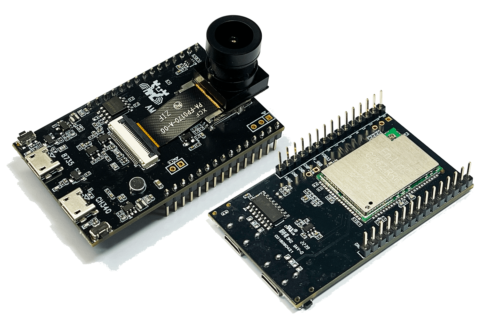
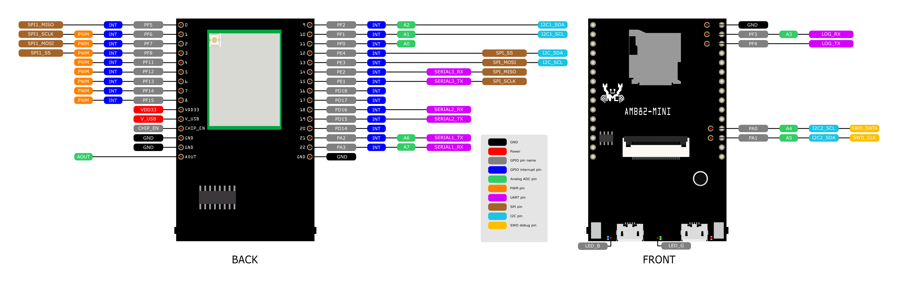
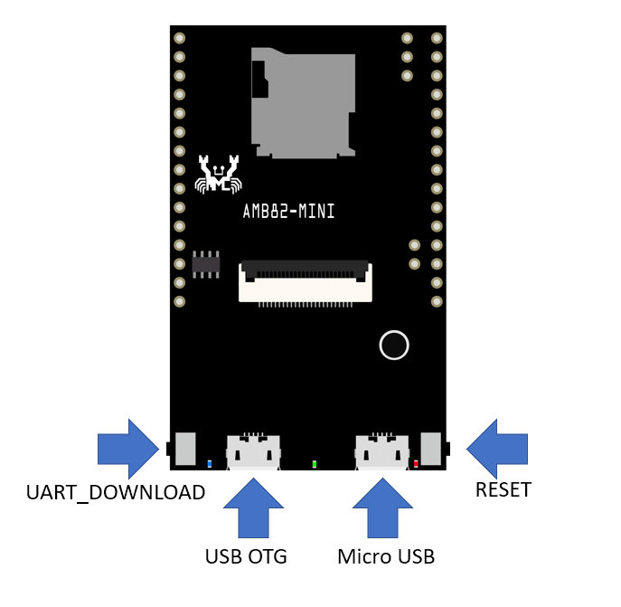
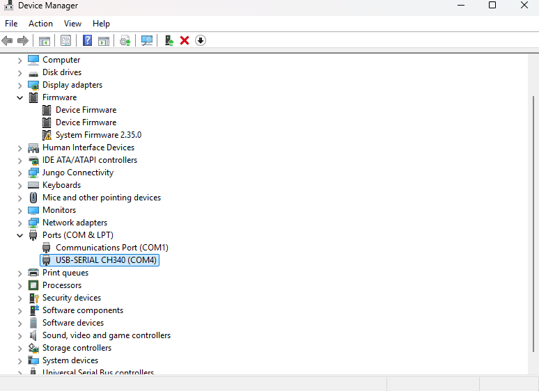
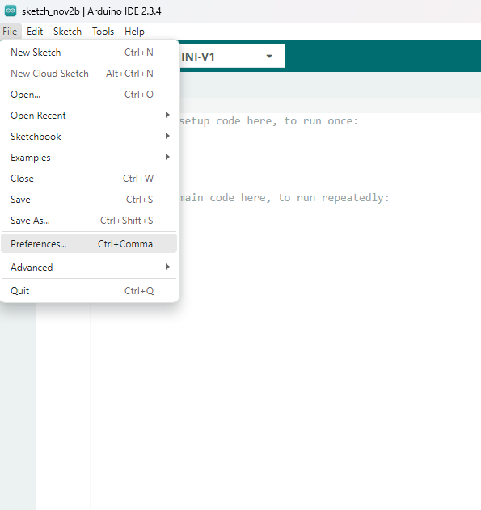
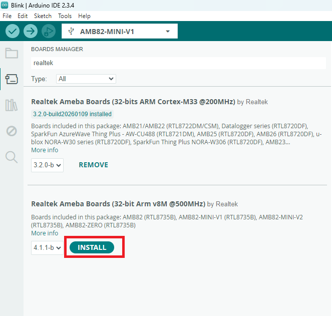
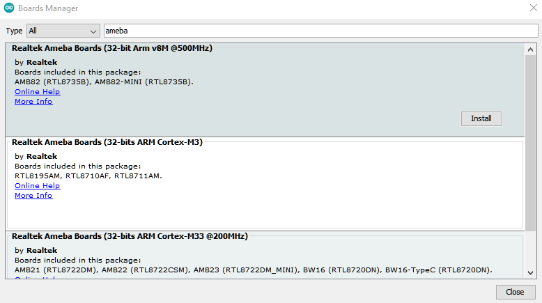
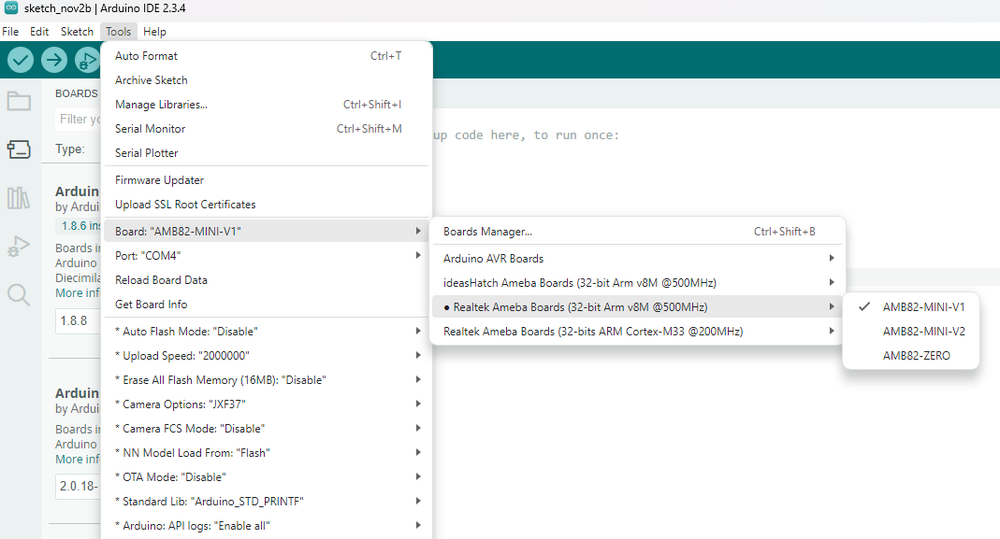
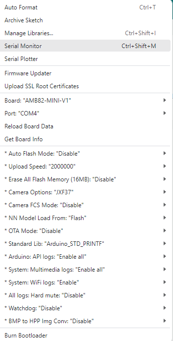
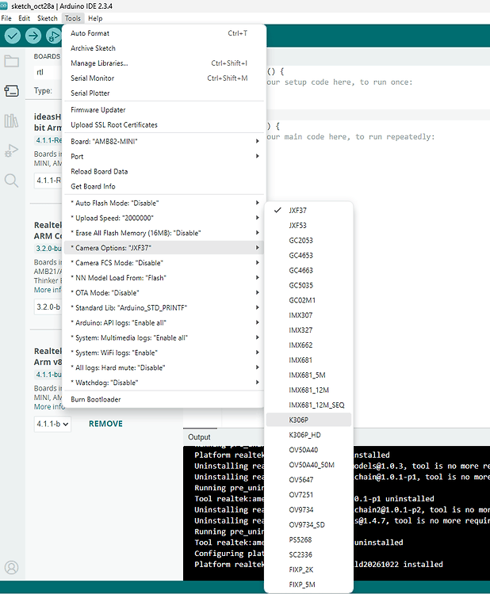
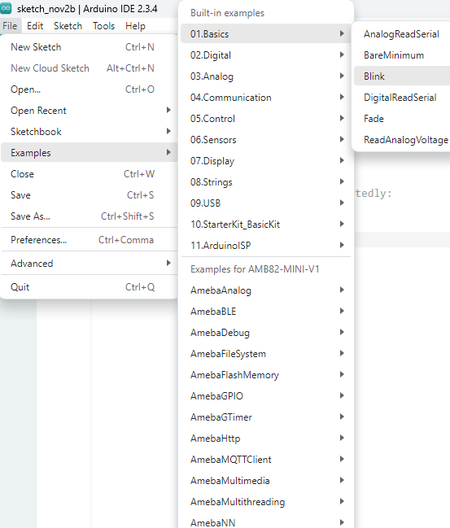
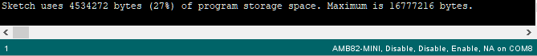
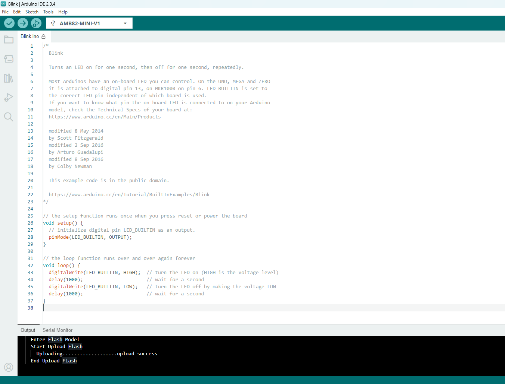
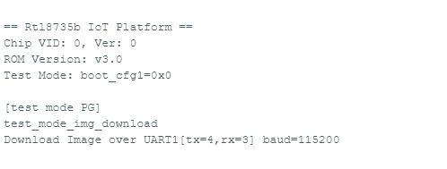
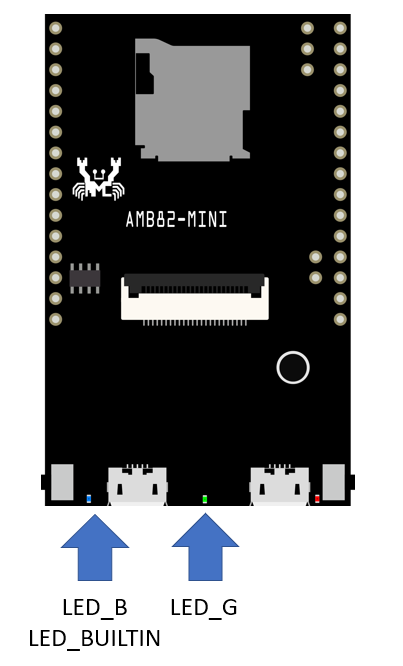